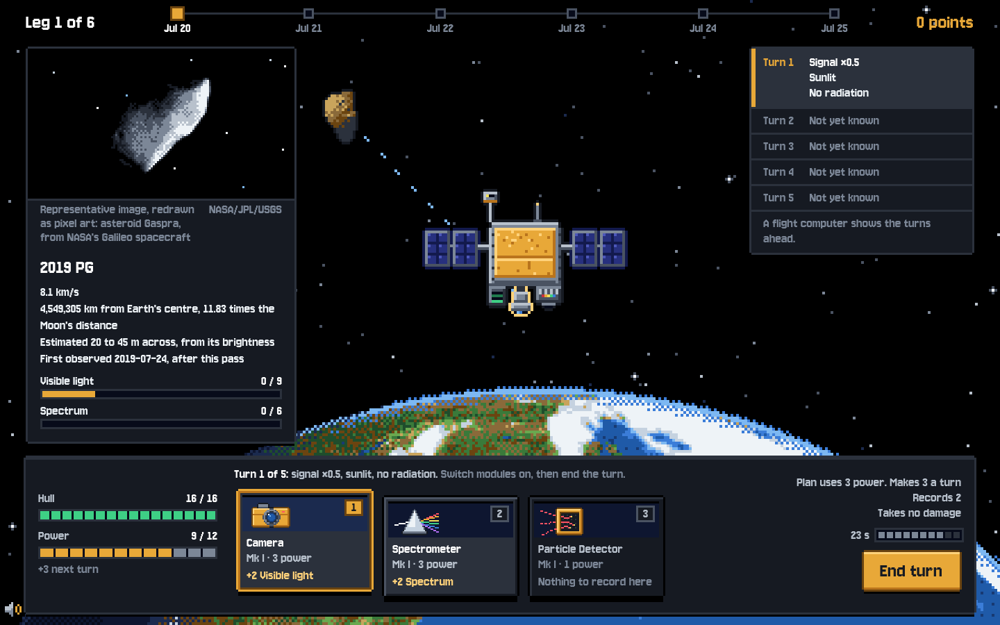
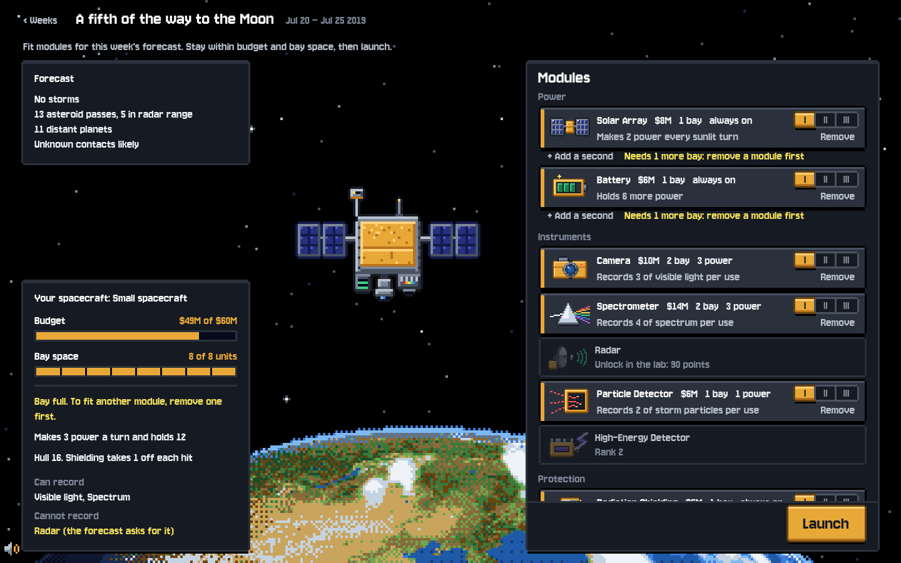
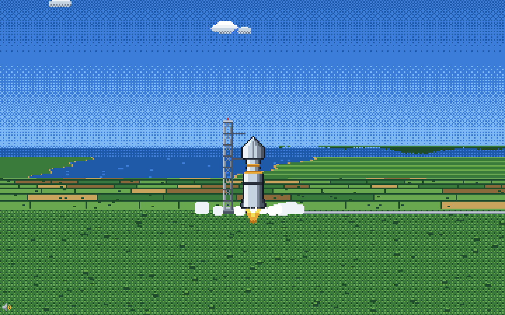

# Artemis 26

Artemis 26 is a pixel-art browser game about designing a small science mission. You fit a spacecraft from module cards (power, instruments, protection) within a budget and a fixed bay, then fly one real week in space: July 2019, autumn 2022 or May 2024. The asteroids that pass, the solar storms that hit and the flares behind them are taken from NASA records for those dates. Each contact you approach can be recorded only by the instrument that matches it, so what you packed decides what you bring home. After the flight the debrief names what you missed and which module would have recorded it, and the lab is where you buy it for the next try.

Play it here: PLAY_URL

Made for the 2026 NASA Space Apps Challenge, "Space Mission Design Game" challenge, by team Artemis 26 in Ankara.







## How to play

1. Choose a week. Each one shows a forecast: storm legs, asteroid passes, planets, and whether unknown contacts are likely.
2. In the hangar, fit modules within the budget and the bay space. Each instrument records one kind of data (visible light, spectrum, radar, particles, X-rays and gamma rays). The hangar lists what you cannot record and whether the forecast asks for it. Then launch.
3. A flight has six legs, one per day or few days of the real week. On each leg, approach one contact. Its bars show the data it holds; a striped bar names the module it needs. Outside storms you can hold instead, which refills power but skips the leg. On a storm leg you cannot hold.
4. An encounter lasts three to five turns. Switch modules on with a click or the keys 1 to 9; they use power, and sunlit turns recharge it. End the turn with the button or Enter. Each turn has 30 seconds; when the time runs out the turn ends with the plan you have.
5. Storms bring radiation. Shielding takes some off every hit and a magnetic shield blocks more when it is switched on. If the hull runs out, the spacecraft is lost and only half the points are banked.
6. The debrief banks your points and lists what you missed and why. Spend points in the lab on new modules and better marks; ranks open the later weeks and larger spacecraft.
7. Sound is synthesised in the browser. The speaker button in the bottom-left corner, or the M key, turns it off and on. Progress, and a flight in progress, are saved in the browser.

## How it answers the challenge

The challenge asks for a game that teaches how space missions are designed. The player practises a small version of that work:

- **Trade-offs under fixed limits.** Every module costs money and bay space. The starting spacecraft is full on day one, so every new module replaces another.
- **Instrument choice against a forecast.** Each week's forecast says what is coming. Asteroids that pass close enough can be measured by radar; storms carry particles and, after a strong flare, X-rays and gamma rays. A spacecraft without the matching instrument records nothing from them.
- **Power and radiation management.** Instruments draw power each turn, solar arrays recharge only in sunlight, and a storm leg forces a choice between recording and protecting the hull.
- **Learning from what was missed.** The debrief shows the points each missing instrument cost, and the next flight can be designed around it.

What is simplified: power costs, capacities, budgets and prices are game values chosen for play, not engineering figures, and the game says so on its Sources screen. Planets are standing targets: they can be met on any leg and are not timed to their real transits. The events and their dates, speeds, distances, sizes and storm strengths are real.

The challenge page lists eight resources on mission design (read on 14 November 2026; the list is on the game's Sources screen with links). The game's data does not come from them: it comes from the NASA sources below. The list is shown for reference.

## The real data

All mission data was downloaded once by `Tools/FetchNasaData.mjs`, saved in `src/Data/Snapshot/`, and ships with the game. Nothing is fetched from NASA while playing, and no API key is used, stored or needed.

| Source | What the game takes from it | Retrieved | Link |
|---|---|---|---|
| NASA/JPL Center for Near-Earth Object Studies: SBDB Close-Approach Data API and Small-Body Database API | Asteroid passes: date, speed, miss distance, estimated size, hazard flag, and the dates each asteroid was first and last observed (83 requests) | 14 November 2026 | [cneos.jpl.nasa.gov/ca](https://cneos.jpl.nasa.gov/ca/), [example request](https://ssd-api.jpl.nasa.gov/cad.api?date-min=2019-07-20&date-max=2019-07-26&dist-max=20LD&fullname=true&diameter=true) |
| NASA Space Weather Database Of Notifications, Knowledge, Information (DONKI) | Geomagnetic storms with their Kp readings, solar energetic particle events, and M and X class flares; storm legs and their radiation are built from them (9 requests) | 14 November 2026 | [ccmc.gsfc.nasa.gov/tools/DONKI](https://ccmc.gsfc.nasa.gov/tools/DONKI/), [example request](https://ccmc.gsfc.nasa.gov/DONKI/api/donki/nuggets/gst/?startDate=2019-07-16%2021%3A00%3A00&endDate=2019-07-26%2003%3A00%3A00) |
| NASA Exoplanet Archive, Planetary Systems Composite Parameters | Eleven distant planets: how and when each was discovered, its distance and its radius (1 request) | 14 November 2026 | [exoplanetarchive.ipac.caltech.edu](https://exoplanetarchive.ipac.caltech.edu/) |
| NASA Image and Video Library, and one NASA article | Nine event pictures, redrawn as pixel art | 14 November 2026 | [images.nasa.gov](https://images.nasa.gov/) |

The two hand-written events and five other "what was learned" lines were checked against the NASA page linked beside each one on the Sources screen (`src/Data/Curated/LearnedSources.ts`).

Across the three weeks the game holds 77 asteroid passes, 5 storm legs, 11 distant planets and 2 rare events.

### The three weeks

- **July 2019, "A fifth of the way to the Moon".** A quiet Sun and no storms. Thirteen asteroids pass within 20 lunar distances. On the last leg, asteroid 2019 OK passes 71,355 km from Earth's centre, less than a fifth of the Moon's distance, at 24.5 km/s; its size is estimated at 58 to 130 m from its brightness.
- **September to October 2022, "Impact and burst".** On 26 September NASA's DART spacecraft struck Dimorphos, a moonlet 160 m across, the first test of deflecting an asteroid by hitting it. On 9 October came GRB 221009A, likely the brightest gamma-ray burst since human civilization began. One storm leg (Kp 6, 27 September) and 36 asteroid passes.
- **May 2024, "The great storm".** The strongest geomagnetic storm in two decades. DONKI records Kp 9 on 10 and 11 May, with energetic particles detected near Earth by SOHO and GOES and class X flares before it. Four of the six legs are storm legs. It opens at rank 3, with the medium spacecraft.

### How honesty is handled

- **Every asteroid pass is computed by NASA/JPL from the asteroid's orbit.** Whether anyone watched it is a separate fact, and the card states it: whether the pass falls between the first and last observations on record, before the first, or after the last.
- **Rough passes are left out.** A pass is dropped when its time is uncertain by more than an hour, or its possible distances spread by more than a quarter of the distance. Fifteen were dropped; the snapshot lists them under `leftOut`.
- **Sizes are estimates from brightness** and the card says so. Distances are from Earth's centre, as JPL gives them, and the card says so.
- **Only detections near Earth count.** Particle events and flares are kept only if an instrument on GOES, SOHO or ACE recorded them; model forecasts and detections at other spacecraft are left out.
- **Pictures are labelled.** Seven of the nine event pictures are representative (no photograph exists of a 30 m asteroid passing Earth, or of these particular storms) and their captions begin "Representative". Illustrations are labelled as illustrations. Each lists its NASA id, credit and original page on the Sources screen.
- **Game numbers are game numbers.** The Sources screen says that power costs, capacities, budgets and prices are chosen for play.

## Use of AI

The idea and the gameplay loop are the team's own: a deck-building spacecraft game where you fit modules, fly a real week and record real events. The team designed the game and directed every step. The project is AI-assisted: the code (engine and interface), the interface design, the pixel art and the sound were produced with Claude under the team's direction. All mission data is real NASA data.

How:

- The tool was Claude, used through Claude Code. Commits made with it carry a `Co-Authored-By: Claude` line.
- The pixel art is generated by the Python scripts in `Tools/` and by drawing code in the repository (the Earth, the spacecraft, the rocket and the scene). The event pictures are redrawn from the NASA images named on the Sources screen. All sound is synthesised in the browser at run time; there are no audio files.
- The game shows an AI notice on its Home screen and its Sources screen.

## Run it locally

Needs Node.js 22.12 or later in the 22 line, 24, or 26 and later (the deploy workflow uses 24).

```
npm ci
npm run dev      # development server, prints the local address
npm test         # unit, data and balance tests
npm run build    # type-check and build into dist/
npm run preview  # serve dist/ locally
```

The build uses relative paths, so `dist/` can be served from a domain root or from a sub-path such as `https://<user>.github.io/<repo>/` without changes. `.github/workflows/Deploy.yml` builds and publishes it to GitHub Pages on every push to `main`.

### Project layout

```
src/
  Engine/       rules, pure TypeScript: modules, spacecraft, events, weeks, flight, progress, bots for balance tests
  Data/         Snapshot/ (downloaded NASA data), Curated/ (weeks, planets, rare events, images, checked lines), GameData.ts
  Interface/    React screens, cards, meters, the canvas backdrop and flight scene, synthesised sound
  State/        game store (zustand), saved data in localStorage, first-flight hints
  I18n/         interface text (StringsEn.json)
  Styles/       CSS
public/         Earth maps, module sprite sheet, event pictures, icon
Art/Source/     the NASA originals the event pictures are redrawn from
Tools/          data download, art generation, screenshot and sound tools, balance probes
```

### Regenerating data and art

```
node Tools/FetchNasaData.mjs [--dry] [--offline]   # download into src/Data/Snapshot; responses are cached in Tools/.cache
python3 Tools/MakeBackdrop.py [outputFolder]       # Earth maps from Tools/Source/EarthDay.jpg and EarthNight.jpg into public/Backdrop
python3 Tools/MakePixelArt.py [contactSheet] [only] # event pictures from Art/Source/Events into public/Images/Events
python3 Tools/MakeModuleSprites.py [preview]       # module sprite sheet into public/Art/ModuleSprites.png
node Tools/CaptureScreens.mjs 1440 900 outFolder [only] [baseUrl]   # screenshots of a running game with headless Chrome
node Tools/RenderSounds.mjs [outFolder] [only]     # render each sound cue to a file for listening
npx vitest run --config Tools/Balance/vitest.config.ts   # the long balance probes behind GameDesign.md
```

The Python scripts need Pillow. The capture and sound tools need Google Chrome.

### Tests

314 tests in 20 files, run with `npm test`. They cover the engine rules (loadout, scanner, encounters, scoring, flights, lab and ranks, determinism and malformed input); data honesty (no key in any saved request, every asteroid in a leg of its week, no roughly known pass, only near-Earth detections, every picture credited, "Representative" captions where they belong, hand-written lines tied to the page they were checked against); the balance targets in `GameDesign.md`, played by bots on the real weeks; and the hints, the flight scene, the turn timer and the sound cues.

## Credits and licences

- Uses public NASA data and imagery. Not affiliated with or endorsed by NASA.
- Asteroid data: NASA/JPL Center for Near-Earth Object Studies. Space weather: NASA Community Coordinated Modeling Center, DONKI. Planets: NASA Exoplanet Archive, operated by Caltech under contract with NASA.
- Event pictures: NASA Image and Video Library and NASA's article on GRB 221009A. Each picture's own credit is shown on its card and on the Sources screen, and listed in `src/Data/Curated/Images.ts`: NASA/JPL; NASA/JPL/USGS; NASA/JPL/JHUAPL; NASA; NASA/GSFC/Solar Dynamics Observatory; NASA/JPL-Caltech; NASA/Johns Hopkins APL/Steve Gribben; NASA/Swift/A. Beardmore (University of Leicester).
- No NASA logo, insignia, flag or mission patch is used.
- Earth imagery: Solar System Scope textures, CC BY 4.0 ([solarsystemscope.com/textures](https://www.solarsystemscope.com/textures/)). The source maps are in `Tools/Source/`; the pixel Earth in `public/Backdrop/` is derived from them.
- Font: Jersey 10, loaded from Google Fonts at run time, SIL Open Font License 1.1.
- Code: the team has not chosen a licence yet.

## Team

Artemis 26, Ankara.

TEAM_MEMBERS
